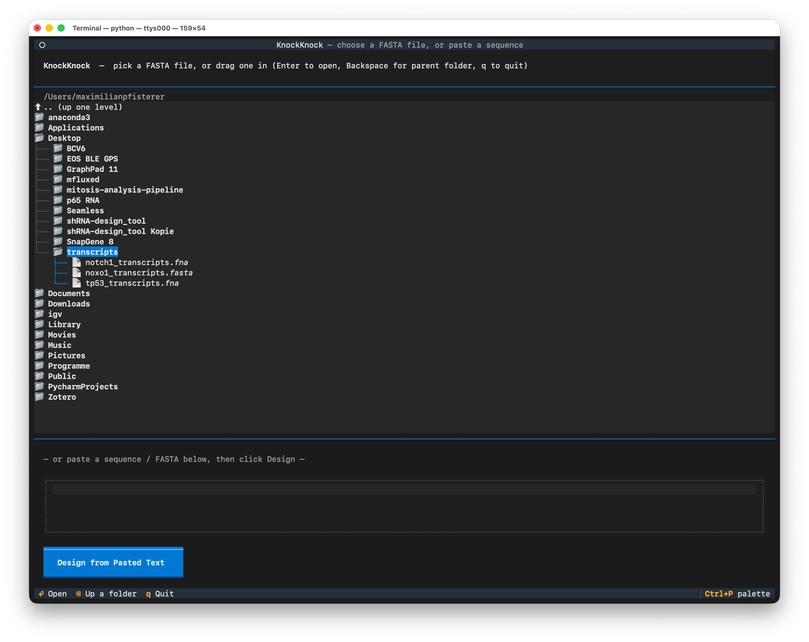
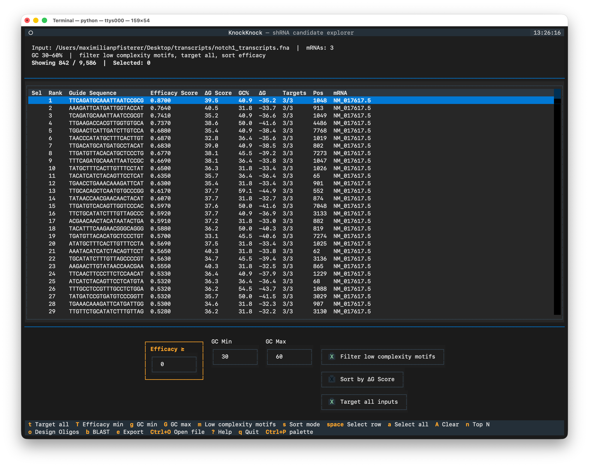
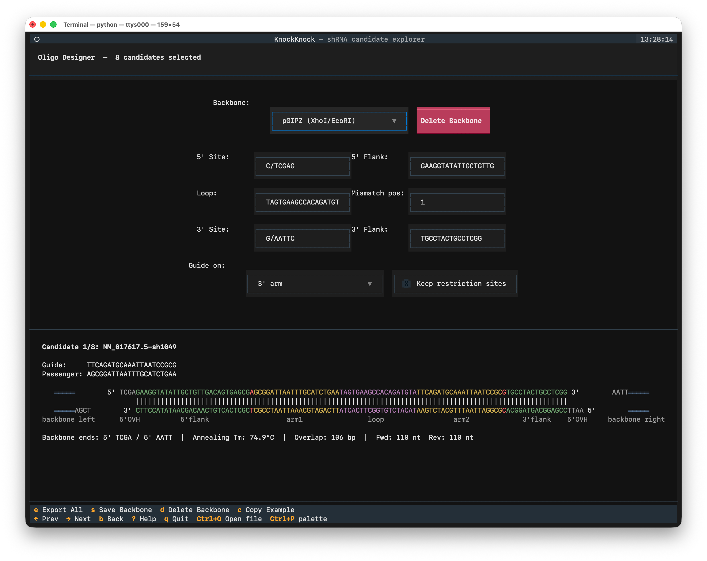

# KnockKnock — TUI Manual

Full reference for KnockKnock's interactive terminal screens: the file picker, the candidate explorer, and the oligo designer. For the command-line reference, see [CLI_MANUAL.md](CLI_MANUAL.md).

## Starting the TUI

```bash
knockknock                       # run the TUI
knockknock <mRNAs.fasta> --tui   # run the TUI, straight from a file
```

## Navigating the TUI

Every screen is operated with the arrow keys and the keyboard shortcuts printed at the bottom of the screen, or with the mouse:

- Click a row in a table to move the cursor to that row.
- Click a checkbox to turn a filter on or off.
- Click a menu to open it, then click an item to select it.
- Click a field to put the cursor in it, then type a value.
- Click an action name in the footer bar to run it, the same as its keyboard shortcut.
- Turn the mouse wheel over a long panel to scroll it.

While the cursor is in a text field, single-letter shortcuts type into the field instead of running their action. Press `Esc` to leave the field; the shortcuts work again.

## The file picker

`knockknock` with no arguments opens a file browser. The tree starts in the current working directory, shown just above it, and lists directories and FASTA-like files only.

1. Move through folders with the arrow keys or the mouse. Press `Enter`, or click, to open a folder or select a file.
2. The first row of the tree is always `.. (up one level)`. Click it, or press `Enter` on it, to step up to the parent folder. `Backspace` does the same from anywhere in the tree.
3. Alternatively, paste a raw sequence or a full FASTA into the text box below the tree and press its submit button. A file dragged onto the terminal window is also accepted.

KnockKnock designs shRNA candidates for the input immediately, then opens the explorer. `Ctrl + O` in the explorer returns to the picker; it reopens rooted at your home directory, expanded down to the file you had loaded, or with the pasted sequence back in the paste box.

The picker never quits on a bad input. An unreadable file, a broken FASTA, or an input yielding no candidates is reported as a message and the picker stays up.

## The explorer screen
### Screen layout
The explorer screen has three parts:
- A summary bar with the input file, the mRNA count, the active filters, and the selection count.
- A table of candidates in the current sort order.
- A filter bar at the bottom, with live GC and efficacy score inputs and checkboxes for the motif filter, the sort mode, and the target-all-inputs filter.

### Table columns
| Column         | Meaning                                                      |
|----------------|--------------------------------------------------------------|
| Sel            | A check mark if this candidate is selected for oligo design.  |
| Rank           | The rank of this candidate in the current view.              |
| Guide Sequence | The shRNA guide (antisense) sequence.                        |
| Efficacy Score | The efficacy score. Higher is better.                        |
| ΔG Score       | A score derived from the free energy of the guide-target duplex. Higher is better. |
| GC%            | The GC content of the guide.                                 |
| ΔG             | The free energy of the guide-target duplex, in kcal/mol. More negative is more stable. |
| Targets        | The number of input sequences this shRNA targets.            |
| Pos            | The position of the guide in the first target sequence.      |
| mRNA           | The name of the targeted sequence.                           |

Candidates are ranked by Efficacy Score. Press `s` to rank by ΔG Score instead.

### Starting filters
The explorer opens with efficacy score ≥ 0, GC 30–60 %, the motif filter on, and target-all-inputs on. If fewer than eight candidates pass those, the filters are widened to GC 0–100 % with no score minimum and target-all off, and a message says so. Adjust any of them in the filter bar.

### Key bindings
| Key         | Action                                                       |
|-------------|--------------------------------------------------------------|
| `Space`     | Select or deselect the candidate at the cursor.              |
| `a`         | Select every candidate in the current view.                  |
| `Shift + A` | Clear every selection.                                       |
| `n`         | Select the top N candidates of the current view.             |
| `s`         | Switch the sort mode between efficacy score and ΔG score.    |
| `m`         | Turn the motif filter on or off. It rejects shRNAs containing repetitive motifs. |
| `t`         | Turn the target-all-inputs filter on or off. It decides whether a candidate must target every input sequence. |
| `Shift + T` | Move the cursor to the efficacy-score-minimum field.         |
| `g`         | Move the cursor to the GC-minimum field.                     |
| `Shift + G` | Move the cursor to the GC-maximum field.                     |
| `o`         | Open the oligo designer for the selected candidates, or for every candidate in the current view if none are selected. |
| `b`         | Open NCBI Nucleotide BLAST in your browser, prefilled with the guide sequences of the selected candidates, or of the current view if none are selected. Capped at 25 sequences. NCBI reuses the database last searched against in that browser; pick another one on the BLAST page. |
| `e`         | Export the current view. A chooser asks for the format: CSV, Excel, JSON, or FASTA. |
| `Ctrl + O`  | Open another input. Selections and filter settings are not carried over. |
| `Esc`       | Leave the focused filter field.                              |
| `x`         | Dismiss the welcome banner. It does not come back.           |
| `?`         | Open the help screen.                                        |
| `q`         | Quit the explorer.                                           |

### Filter and select candidates
1. Type a value into the GC Min, GC Max, or Efficacy field to narrow the candidate list.
2. Press `m` to turn the motif filter on or off.
3. Press `Space` on a row to mark that candidate.
4. Repeat step 3 for each candidate you want, or press `a` to mark every candidate in the current view.
5. Press `o` to open the oligo designer for your marked candidates.

### Export the candidate list
1. Press `e`. A chooser asks for the file format.
2. Press `1` for CSV, `2` for Excel, `3` for JSON, or `4` for FASTA, or use the arrow keys and `Enter`. `Esc` cancels.
3. The file is written next to your input file, and the full path is shown in a message.

The export records the filters currently applied in the view, not the ones the session started with.

## The oligo designer

The oligo designer turns the candidates into cloning oligos for a chosen backbone. It shows a colour-coded diagram of the annealed insert for one candidate at a time; each colour marks one segment: the flank, the guide or passenger arm, the mismatch, the loop, and the backbone.

### Key bindings
| Key       | Action                                                       |
|-----------|--------------------------------------------------------------|
| `←` / `→` | Move to the previous or next candidate.                      |
| `c`       | Copy the displayed forward and reverse oligo pair to the clipboard, in FASTA form. |
| `e`       | Export every candidate together with its assembled oligo pair, as two files: one candidate table and one oligo-pair table. A chooser asks for the format: FASTA, CSV, or JSON. |
| `s`       | Save the current sites, flanks, and loop as a new named backbone. |
| `d`       | Delete the selected backbone, after a confirmation prompt. Not available while `Custom` is selected. |
| `b`       | Return to the explorer screen.                               |
| `Esc`     | Leave the focused configuration field.                       |
| `?`       | Open the help screen.                                        |
| `q`       | Quit.                                                        |

### Backbone configuration
The top of the screen has these fields:

- **Backbone** — a named preset, or `Custom`. Selecting a preset fills in its sites, flanks, and loop.
- **5' Site** and **3' Site** — the two ends of the **digested backbone**. The oligos are designed to be complementary to them.
  Enzymes that cut inside their recognition sequence are entered in cut-site notation, with a slash at the top-strand cut position: `G/AATTC` for EcoRI, `CTGCA/G` for PstI.
  Enzymes that cut outside their recognition sequence are entered as the overhang itself: `5'AATT`, `3'TGCA`, or `blunt`.
  A degenerate base (`N`, `R`, `Y`, …) is accepted in a cut site as long as it does not fall on the overhang. `N/TCGAG` still leaves a definite `TCGA` overhang; `CACNNN/GTG` is rejected, because there the `N` region *is* the overhang.
- **Keep restriction sites** — The insert normally carries the overhang only, which leaves a scarred junction the enzyme can no longer cut. With the box ticked, the insert also carries its half of each recognition sequence, so the site re-forms on ligation. Both oligos and the annealing Tm grow accordingly.
- **5' Flank** and **3' Flank** — the constant sequence next to the guide and passenger arms.
- **Loop** — the hairpin loop between the two arms.
- **Mismatch pos** — one or more positions, comma-separated, for example `1` or `1,2`. The default is `1`. Positions count from the base of the stem, the end nearest the flanking sequence and farthest from the loop. `0` on its own disables mismatch introduction.
- **Guide on** — whether the guide arm sits on the 5' or the 3' side of the loop.

Editing any field by hand switches the Backbone selector to `Custom` and puts a **Save Backbone** button next to it. Click it, or press `s`, to store the current sites, flanks, and loop as a new named row in the backbone database; it then appears in the Backbone dropdown. While a saved backbone is selected, the button reads **Delete Backbone** instead: click it, or press `d`, and confirm to remove that row. Any backbone can be deleted, including the bundled ones, because deletion edits your own copy of the database only. Restore bundled backbones with `knockknock --restore-backbones` on the command line.

### Design and export oligos
1. In the explorer, mark the candidates you want, or leave the selection empty to use every candidate in the current view.
2. Press `o` to open the oligo designer.
3. Select a backbone in the Backbone field, or fill in the site and sequence fields by hand.
4. Use `←` and `→` to check the diagram for each candidate.
5. Read the warning lines below the diagram, if there are any.
6. Press `e` to export every candidate with its oligo pair.
7. Press `1`, `2`, or `3` in the chooser to select the file format.

## Getting help
Press `?` on any screen to open the help screen. It explains the table columns and lists the shortcuts of both screens. Press `Esc`, `?`, or `q` to close it.
